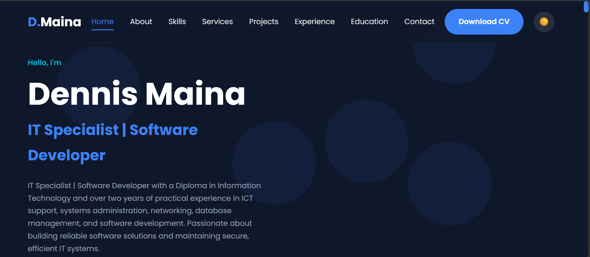
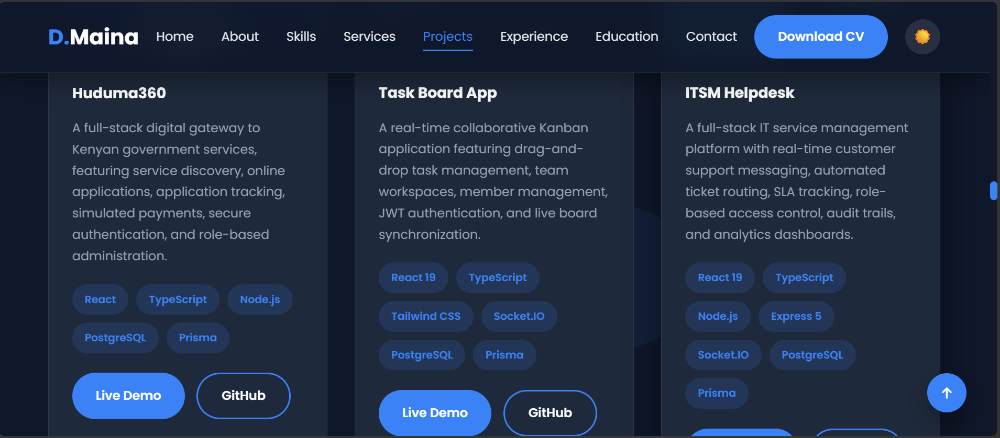
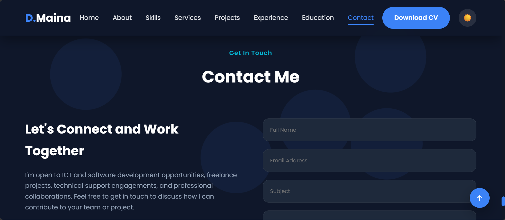

# Dennis Maina — Portfolio Website

A fast, responsive, and fully static personal portfolio built with HTML5, CSS3, and vanilla JavaScript. The website showcases my skills, projects, experience, and professional background through a modern, responsive interface.

Built without a frontend framework, build tools, or a backend, the website can be opened locally or deployed directly to Vercel.

## Live Demo

- **Website:** [Visit My Portfolio](YOUR_VERCEL_URL)
- **GitHub Repository:** [View Source Code](YOUR_GITHUB_REPOSITORY_URL)

> Replace the placeholder URLs above with your actual website and repository links after deployment.

## Screenshots

Here is a preview of my portfolio website.

### Homepage



### Portfolio Preview



### Additional Preview



## Features

- **Responsive Design:** Optimised for desktop, tablet, and mobile devices.
- **Light and Dark Themes:** Switch between themes, with the selected preference remembered.
- **Animated Interface:** Scroll-reveal animations, animated skill bars, and a statistics counter.
- **Interactive Navigation:** Hamburger menu for smaller screens and active-section highlighting.
- **Back-to-Top Button:** Quickly return to the top of the page.
- **Contact Form:** Client-side input validation.
- **Accessibility:** Semantic HTML, page landmarks, a skip link, labelled controls, and keyboard-friendly navigation.
- **Downloadable CV:** Dedicated CV download functionality.
- **Project Showcase:** Sections for displaying projects, technologies, and development experience.

## Tech Stack

| Layer           | Technology                                                          | Purpose                                                   |
| --------------- | ------------------------------------------------------------------- | --------------------------------------------------------- |
| Markup          | HTML5                                                               | Semantic page structure and content                       |
| Styling         | CSS3                                                                | Responsive layouts, animations, themes, and visual design |
| Behaviour       | Vanilla JavaScript (ES6+)                                           | Navigation, interactions, animations, and form validation |
| Layout          | CSS Grid and Flexbox                                                | Responsive page layouts                                   |
| Typography      | [Google Fonts — Poppins](https://fonts.google.com/specimen/Poppins) | Website typography                                        |
| Icons           | [Font Awesome](https://fontawesome.com/) 6.6                        | Interface and social media icons                          |
| Hosting         | [Vercel](https://vercel.com/)                                       | Static website deployment                                 |
| Version Control | [Git](https://git-scm.com/) and [GitHub](https://github.com/)       | Source code management and version control                |

## Project Structure

```text
my-portfolio/
├── index.html
├── README.md
├── .gitignore
│
├── assets/
│   └── images/
│       └── favicon.svg
│
├── css/
│   └── styles.css
│
├── js/
│   └── script.js
│
├── documents/
│   └── Dennis-Maina-CV.pdf
│
└── screenshots/
    ├── 1.png
    ├── 2.png
    └── 3.png
```

## Getting Started

You can run this project locally without installing any dependencies.

### Prerequisites

- A modern web browser.
- A code editor such as [Visual Studio Code](https://code.visualstudio.com/) if you want to inspect or modify the source code.
- An internet connection to load external fonts and icons.

### Run Locally

**Option 1: Open directly**

1. Download or clone the repository.
2. Navigate to the project folder.
3. Open `index.html` in your browser.

**Option 2: Use Visual Studio Code Live Server**

1. Open the project folder in Visual Studio Code.
2. Install the Live Server extension if it is not already installed.
3. Right-click `index.html`.
4. Select **Open with Live Server**.

**Option 3: Use a local static server**

If Node.js is installed, run the following command from the project directory:

```bash
npx serve .
```

Open the local URL displayed in your terminal.

## Deployment to Vercel

This is a static website, so no build command or framework configuration is required.

### Step 1: Push the Project to GitHub

Create an empty repository on GitHub, then open a terminal in your project directory and run:

```bash
git init
git add .
git commit -m "Initial commit: portfolio website"
git branch -M main
git remote add origin https://github.com/YOUR_USERNAME/YOUR_REPOSITORY.git
git push -u origin main
```

Replace `YOUR_USERNAME` and `YOUR_REPOSITORY` with your actual GitHub username and repository name.

If your project is already connected to a GitHub repository, you do not need to repeat the initialisation or remote configuration steps.

### Step 2: Import the Repository into Vercel

1. Visit [Vercel New Project](https://vercel.com/new).
2. Sign in using your GitHub account.
3. Import your portfolio repository.

### Step 3: Configure the Project

Use the following settings:

| Setting          | Value       |
| ---------------- | ----------- |
| Framework Preset | Other       |
| Root Directory   | `./`        |
| Build Command    | Leave empty |
| Output Directory | Leave empty |
| Install Command  | Leave empty |

No build process is required because the project uses plain HTML, CSS, and JavaScript.

### Step 4: Deploy

Click **Deploy** and wait for Vercel to publish the website.

Your portfolio will be available at a URL similar to:

`https://your-project-name.vercel.app`

You can configure a custom domain under your project's Vercel settings.

### Automatic Deployments

Once the GitHub repository is connected to Vercel, subsequent pushes to the production branch will trigger deployments automatically.

For example:

```bash
git add .
git commit -m "Update portfolio content"
git push origin main
```

Vercel can also generate preview deployments for pull requests.

## CV Download

My CV is stored in the `documents/` directory.

To make the download button work, ensure the link in `index.html` points to the correct file:

```html
<a href="documents/Dennis-Maina-CV.pdf" class="btn btn-primary" download>
  Download CV
</a>
```

The path and filename must match the actual location and name of the PDF file.

## Contact Form

The contact form currently performs client-side validation.

**Important:** The form does not send messages to a server or email inbox because the project does not have a backend or form-processing integration. Any success message displayed by the frontend does not confirm that a message has been delivered.

To receive submissions, integrate a form-processing service such as [Formspree](https://formspree.io/), [Web3Forms](https://web3forms.com/), or [Getform](https://getform.io/).

Alternatively, provide a direct email link using the `mailto:` protocol.

## SEO and Social Sharing

After deployment, consider adding canonical and Open Graph metadata to the `<head>` section of `index.html`.

Replace `YOUR_VERCEL_URL` with your actual production domain.

```html
<link rel="canonical" href="https://YOUR_VERCEL_URL/" />

<meta property="og:type" content="website" />
<meta property="og:title" content="Dennis Maina | Developer Portfolio" />
<meta
  property="og:description"
  content="Explore my projects, technical skills, and professional portfolio."
/>
<meta property="og:url" content="https://YOUR_VERCEL_URL/" />
<meta
  property="og:image"
  content="https://YOUR_VERCEL_URL/assets/images/og-image.png"
/>
```

For the best social-sharing experience, create an Open Graph image measuring **1200 × 630 pixels** and save it as `og-image.png` in `assets/images/`.

Ensure the image exists before referencing it in your metadata.

## Pre-Deployment Checklist

Before sharing the portfolio with recruiters, employers, or potential clients, verify the following:

- [ ] Replace all placeholder social media and contact links with the correct URLs.
- [ ] Confirm that the CV download button points to `documents/Dennis-Maina-CV.pdf`.
- [ ] Update project descriptions, technology tags, GitHub links, and live demos.
- [ ] Ensure testimonials, statistics, experience, and certifications accurately represent your background.
- [ ] Replace placeholder profile images and project visuals with appropriate images.
- [ ] Verify that the navigation menu and theme toggle work correctly.
- [ ] Test the contact form and clearly communicate its current limitations.
- [ ] Test the website on desktop, tablet, and mobile devices.
- [ ] Check for broken links and missing assets.
- [ ] Add your actual live website URL and GitHub repository URL to this README.
- [ ] Confirm that the screenshots displayed in this README match the current website.

## Known Issues and Improvements

The current implementation retains several visual and animation behaviours that may need further refinement:

- **Invisible profile and project images:** Elements using `.reveal-scale` may remain invisible if the corresponding `.active` state is not defined. Consider adding the appropriate active-state CSS rule.
- **Animation and hover interactions:** Some card animations may override hover transforms and JavaScript tilt effects. Review the animation and transform rules if these interactions are required.
- **Skill bar animations:** Skill bars may jump directly to their target widths instead of animating smoothly. Consider adding a width transition to the `.progress` element.

These behaviours should be tested against the current implementation before making changes.

## License

All rights reserved. This is the personal portfolio of Dennis Maina.

The content, personal branding, and CV are intended for professional portfolio use. Please contact me before reproducing or redistributing these materials.

Portfolio deployment verified.
